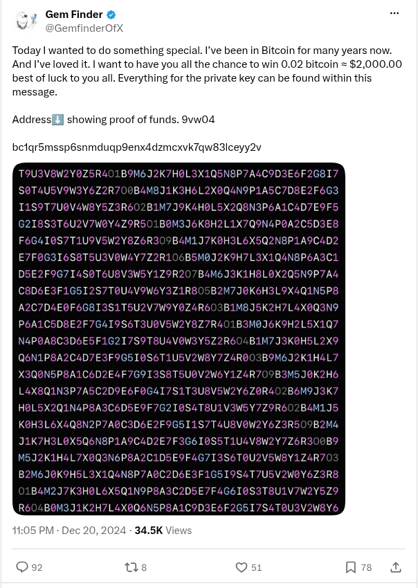

# Gem Finder's 0.02 BTC puzzle post

[Original post](https://x.com/GemfinderOfX/status/1870319691295764655). Cited by the [9vw04 record](../../../src/collections/9vw04.ts) as its source: the paragraph, the token 9vw04, the address and the picture.

## Historical provenance

No capture found. The Wayback Machine index and the MemGator aggregator were searched on October 16, 2026 for both the `twitter.com` and `x.com` URL, and a prefix query on the author's statuses lists nothing older than February 2026. So the transcript below was checked against X's API text, the current post and the screenshot.

## Transcript

> Today I wanted to do something special. I’ve been in Bitcoin for many years now. And I’ve loved it. I want to have you all the chance to win 0.02 bitcoin ≈ $2,000.00 best of luck to you all. Everything for the private key can be found within this message.
>
> Address⬇️ showing proof of funds. 9vw04
>
> bc1qr5mssp6snmduqp9enx4dzmcxvk7qw83lceyy2v

## Screenshot

Rendered from the logged out `x.com` post page through Steel and cropped to the post, because X's public embed cuts this one behind Show more. The displayed 11:05 PM, December 20 timestamp is local to that browser (UTC-5). The frontmatter date is December 21 in UTC. The attached picture is the grid of coloured letters and digits; its original upload is the record's [puzzle.jpg](../../9vw04/puzzle.jpg). Capture method and limits: [source archive](../README.md).
