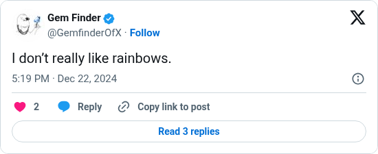

# I don't really like rainbows

[Original post](https://x.com/GemfinderOfX/status/1870866790752141328). Cited by the [9vw04 record](../../../src/collections/9vw04.ts) for the first rainbow hint, a reply the day after the puzzle.

## Historical provenance

No capture found. The Wayback Machine index and the MemGator aggregator were searched on October 16, 2026 for both the `twitter.com` and `x.com` URL, and a prefix query on the author's statuses lists nothing older than February 2026. So the transcript below was checked against X's API text, the current post and the screenshot.

## Transcript

> I don’t really like rainbows.

## Screenshot

Rendered from X's public embed in a local headless Chromium, which is why it shows a Follow button. The displayed 5:19 PM timestamp is local to that browser (UTC+1). The frontmatter date is December 22 in UTC. Capture method and limits: [source archive](../README.md).
