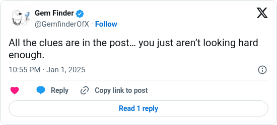

# All the clues are in the post

[Original post](https://x.com/GemfinderOfX/status/1874575103230652759). Cited by the [9vw04 record](../../../src/collections/9vw04.ts) for the reply that keeps everyone in the post.

## Historical provenance

[Wayback capture from January 1, 2025, 21:55:07 UTC](https://web.archive.org/web/20250101215507/https://twitter.com/IrrationalLibs/status/1874575103230652759) is X's JSON payload for the post, taken under the account's old name, IrrationalLibs. Its `text` field carries the same wording as the transcript below, apart from the leading @onyxdeveloper mention. The author ID, 1478800308889395208, is the GemfinderOfX account.

## Transcript

> All the clues are in the post… you just aren’t looking hard enough.

## Screenshot

Rendered from X's public embed in a local headless Chromium, which is why it shows a Follow button. The displayed 10:55 PM timestamp is local to that browser (UTC+1). The frontmatter date is January 1 in UTC. Capture method and limits: [source archive](../README.md).
