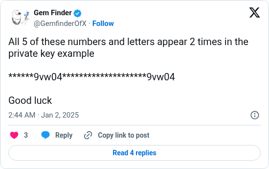

# The private key example

[Original post](https://x.com/GemfinderOfX/status/1874632897459871930). Cited by the [9vw04 record](../../../src/collections/9vw04.ts) for the masked private key example with 9vw04 in it twice.

## Historical provenance

No capture found. The Wayback Machine index and the MemGator aggregator were searched on October 16, 2026 for both the `twitter.com` and `x.com` URL, and a prefix query on the author's statuses lists nothing older than February 2026. So the transcript below was checked against X's API text, the current post and the screenshot.

## Transcript

> All 5 of these numbers and letters appear 2 times in the private key example
>
> \*\*\*\*\*\*9vw04\*\*\*\*\*\*\*\*\*\*\*\*\*\*\*\*\*\*\*\*9vw04
>
> Good luck

## Screenshot

Rendered from X's public embed in a local headless Chromium, which is why it shows a Follow button. The displayed 2:44 AM timestamp is local to that browser (UTC+1). The frontmatter date is January 2 in UTC. Capture method and limits: [source archive](../README.md).
