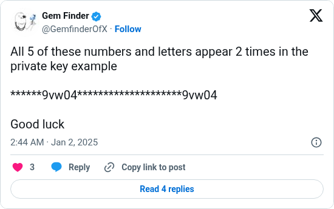

# The private key example

[Original post](https://x.com/GemfinderOfX/status/1874632897459871930). Cited by the [9vw04 record](../../../src/collections/9vw04.ts) for the masked private key example with 9vw04 in it twice.

## Historical provenance

[Wayback capture from January 2, 2025, 01:44:46 UTC](https://web.archive.org/web/20250102014446/https://twitter.com/IrrationalLibs/status/1874632897459871930) is X's JSON payload for the post, taken under the account's old name, IrrationalLibs. Its `text` field carries the same wording as the transcript below, apart from the leading @world73413383 mention. The author ID, 1478800308889395208, is the GemfinderOfX account.

## Transcript

> All 5 of these numbers and letters appear 2 times in the private key example
>
> \*\*\*\*\*\*9vw04\*\*\*\*\*\*\*\*\*\*\*\*\*\*\*\*\*\*\*\*9vw04
>
> Good luck

## Screenshot

Rendered from X's public embed in a local headless Chromium, which is why it shows a Follow button. The displayed 2:44 AM timestamp is local to that browser (UTC+1). The frontmatter date is January 2 in UTC. Capture method and limits: [source archive](../README.md).
