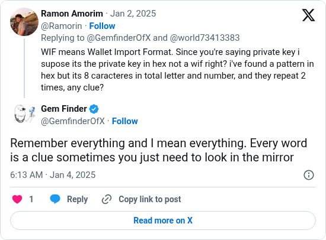

# Look in the mirror

[Original post](https://x.com/GemfinderOfX/status/1875410257754882121). Cited by the [9vw04 record](../../../src/collections/9vw04.ts) for the mirror hint.

## Historical provenance

[Wayback capture from January 4, 2025, 05:13:43 UTC](https://web.archive.org/web/20250104051343/https://twitter.com/IrrationalLibs/status/1875410257754882121) is X's JSON payload for the post, taken under the account's old name, IrrationalLibs. Its `text` field carries the same wording as the transcript below, apart from the leading @Ramorin and @world73413383 mentions. The author ID, 1478800308889395208, is the GemfinderOfX account.

## Transcript

> Remember everything and I mean everything. Every word is a clue sometimes you just need to look in the mirror

## Screenshot

Rendered from X's public embed in a local headless Chromium, which is why it shows a Follow button and the post it answers above it. The displayed 6:13 AM timestamp is local to that browser (UTC+1). The frontmatter date is January 4 in UTC. Capture method and limits: [source archive](../README.md).
