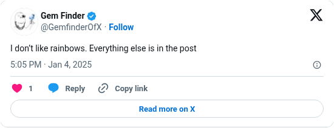

# Everything else is in the post

[Original post](https://x.com/GemfinderOfX/status/1875574373853360303). Cited by the [9vw04 record](../../../src/collections/9vw04.ts) for the second time the author waved rainbows away.

## Historical provenance

[Wayback capture from January 4, 2025, 16:05:51 UTC](https://web.archive.org/web/20250104160551/https://twitter.com/IrrationalLibs/status/1875574373853360303) is X's JSON payload for the post, taken the second it went up under the account's old name, IrrationalLibs. Its `text` field carries the same wording as the transcript below, apart from the leading @unsightreadabl3 mention. The author ID, 1478800308889395208, is the GemfinderOfX account.

## Transcript

> I don’t like rainbows. Everything else is in the post

## Screenshot

Rendered from X's public embed in a local headless Chromium, which is why it shows a Follow button. The displayed 5:05 PM timestamp is local to that browser (UTC+1). The frontmatter date is January 4 in UTC. Capture method and limits: [source archive](../README.md).
