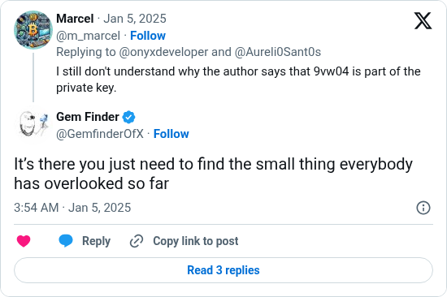

# The small thing everybody overlooked

[Original post](https://x.com/GemfinderOfX/status/1875737695177339343). Cited by the [9vw04 record](../../../src/collections/9vw04.ts) for the hint about something small nobody has spotted.

## Historical provenance

[Wayback capture from January 5, 2025, 02:54:50 UTC](https://web.archive.org/web/20250105025450/https://twitter.com/IrrationalLibs/status/1875737695177339343) is X's JSON payload for the post, taken under the account's old name, IrrationalLibs. Its `text` field carries the same wording as the transcript below, apart from the three leading mentions. The author ID, 1478800308889395208, is the GemfinderOfX account.

## Transcript

> It’s there you just need to find the small thing everybody has overlooked so far

## Screenshot

Rendered from X's public embed in a local headless Chromium, which is why it shows a Follow button and the post it answers above it. The displayed 3:54 AM timestamp is local to that browser (UTC+1). The frontmatter date is January 5 in UTC. Capture method and limits: [source archive](../README.md).
