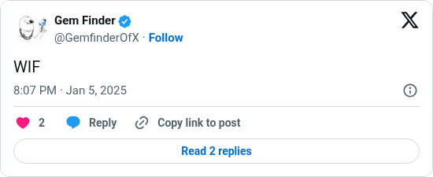

# WIF

[Original post](https://x.com/GemfinderOfX/status/1875982446598181044). Cited by the [9vw04 record](../../../src/collections/9vw04.ts) for the first time the author names the key format.

## Historical provenance

[Wayback capture from January 5, 2025, 19:07:23 UTC](https://web.archive.org/web/20250105190723/https://twitter.com/IrrationalLibs/status/1875982446598181044) is X's JSON payload for the post, taken under the account's old name, IrrationalLibs. Its `text` field carries the same wording as the transcript below, apart from the leading @ape_reunionn mention. The author ID, 1478800308889395208, is the GemfinderOfX account.

## Transcript

> WIF

## Screenshot

Rendered from X's public embed in a local headless Chromium, which is why it shows a Follow button. The displayed 8:07 PM timestamp is local to that browser (UTC+1). The frontmatter date is January 5 in UTC. Capture method and limits: [source archive](../README.md).
