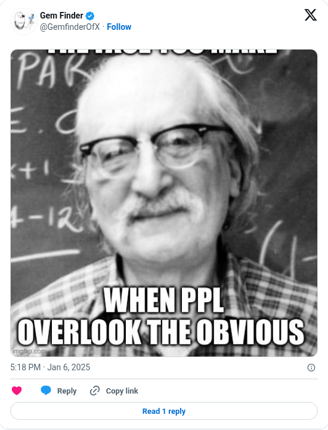

# The face you make when people overlook the obvious

[Original post](https://x.com/GemfinderOfX/status/1876302447796486163). Cited by the [9vw04 record](../../../src/collections/9vw04.ts) for the meme with Daniel Shanks a week before the author named him.

## Historical provenance

[Wayback capture from January 6, 2025, 16:18:58 UTC](https://web.archive.org/web/20250106161858/https://twitter.com/IrrationalLibs/status/1876302447796486163) is X's JSON payload for the post under the account's old name, IrrationalLibs. Its `text` field is the four @mentions and the t.co link to the photo, and its media entry is the same `Ggn3IcdXIAgCAME.jpg` the record ships. The author ID, 1478800308889395208, is the GemfinderOfX account.

## Transcript

> [photo](../../9vw04/shanks.jpg)

## Screenshot

Rendered from X's public embed in a local headless Chromium, which is why it shows a Follow button and no text above the photo. The displayed 5:18 PM timestamp is local to that browser (UTC+1). The frontmatter date is January 6 in UTC. The photo is an imgflip meme of Daniel Shanks at a blackboard. Its caption, THE FACE YOU MAKE WHEN PPL OVERLOOK THE OBVIOUS, is the only text in the post, and its original upload is the record's [shanks.jpg](../../9vw04/shanks.jpg). Two minutes later the author sent the same picture to a second reply, 1876302952450883586, byte for byte. Capture method and limits: [source archive](../README.md).
