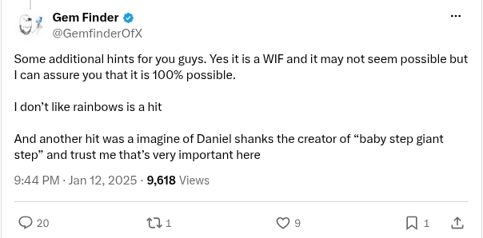

# Additional hints: WIF, rainbows and Daniel Shanks

[Original post](https://x.com/GemfinderOfX/status/1878634169410203733). Cited by the [9vw04 record](../../../src/collections/9vw04.ts) for three hints at once: the WIF, the rainbows and Daniel Shanks.

## Historical provenance

No capture found. The Wayback Machine index and the MemGator aggregator were searched on October 16, 2026 for both the `twitter.com` and `x.com` URL, and a prefix query on the author's statuses lists nothing older than February 2026. So the transcript below was checked against X's API text, the current post and the screenshot.

## Transcript

> Some additional hints for you guys. Yes it is a WIF and it may not seem possible but I can assure you that it is 100% possible.
>
> I don’t like rainbows is a hit
>
> And another hit was a imagine of Daniel shanks the creator of “baby step giant step” and trust me that’s very important here

## Screenshot

Rendered from the logged out `x.com` post page through Steel and cropped to the post, because X's public embed cuts this one behind Show more. The displayed 9:44 PM, January 12 timestamp is local to that browser (UTC-5). The frontmatter date is January 13 in UTC. Capture method and limits: [source archive](../README.md).
