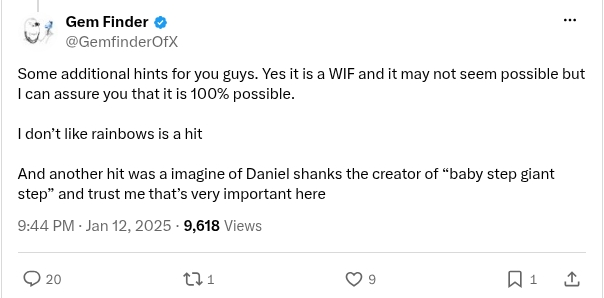

# Additional hints: WIF, rainbows and Daniel Shanks

[Original post](https://x.com/GemfinderOfX/status/1878634169410203733). Cited by the [9vw04 record](../../../src/collections/9vw04.ts) for three hints at once: the WIF, the rainbows and Daniel Shanks.

## Historical provenance

[Wayback capture from January 13, 2025, 02:44:23 UTC](https://web.archive.org/web/20250113024423/https://twitter.com/IrrationalLibs/status/1878634169410203733) is X's JSON payload for the post, taken under the account's old name, IrrationalLibs. Its `text` field stops at "very…", and its `note_tweet` field carries the whole post in the same wording as the transcript below. The author ID, 1478800308889395208, is the GemfinderOfX account.

## Transcript

> Some additional hints for you guys. Yes it is a WIF and it may not seem possible but I can assure you that it is 100% possible.
>
> I don’t like rainbows is a hit
>
> And another hit was a imagine of Daniel shanks the creator of “baby step giant step” and trust me that’s very important here

## Screenshot

Rendered from the logged out `x.com` post page through Steel and cropped to the post, because X's public embed cuts this one behind Show more. The displayed 9:44 PM, January 12 timestamp is local to that browser (UTC-5). The frontmatter date is January 13 in UTC. Capture method and limits: [source archive](../README.md).
