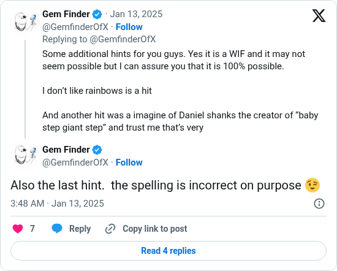

# The spelling is incorrect on purpose

[Original post](https://x.com/GemfinderOfX/status/1878635172754788512). Cited by the [9vw04 record](../../../src/collections/9vw04.ts) for the note that the misspellings are deliberate.

## Historical provenance

[Wayback capture from January 13, 2025, 02:48:23 UTC](https://web.archive.org/web/20250113024823/https://twitter.com/IrrationalLibs/status/1878635172754788512) is X's JSON payload for the post, taken under the account's old name, IrrationalLibs. Its `text` field carries the same wording as the transcript below. The author ID, 1478800308889395208, is the GemfinderOfX account.

## Transcript

> Also the last hint. the spelling is incorrect on purpose 😉

## Screenshot

Rendered from X's public embed in a local headless Chromium, which is why it shows a Follow button and the post it answers above it. The displayed 3:48 AM timestamp is local to that browser (UTC+1). The frontmatter date is January 13 in UTC. Capture method and limits: [source archive](../README.md).
