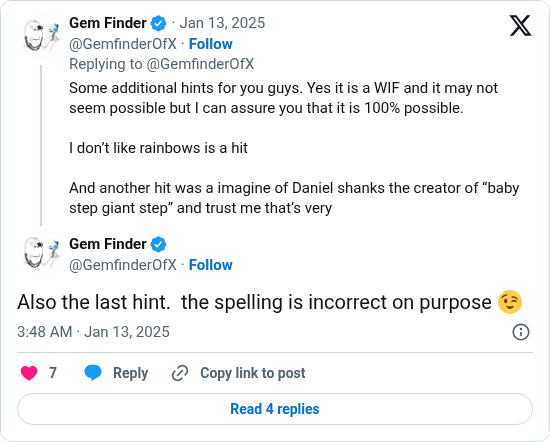

# The spelling is incorrect on purpose

[Original post](https://x.com/GemfinderOfX/status/1878635172754788512). Cited by the [9vw04 record](../../../src/collections/9vw04.ts) for the note that the misspellings are deliberate.

## Historical provenance

No capture found. The Wayback Machine index and the MemGator aggregator were searched on October 16, 2026 for both the `twitter.com` and `x.com` URL, and a prefix query on the author's statuses lists nothing older than February 2026. So the transcript below was checked against X's API text, the current post and the screenshot.

## Transcript

> Also the last hint. the spelling is incorrect on purpose 😉

## Screenshot

Rendered from X's public embed in a local headless Chromium, which is why it shows a Follow button and the post it answers above it. The displayed 3:48 AM timestamp is local to that browser (UTC+1). The frontmatter date is January 13 in UTC. Capture method and limits: [source archive](../README.md).
