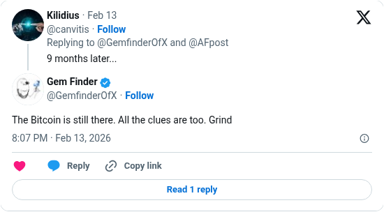

# The Bitcoin is still there

[Original post](https://x.com/GemfinderOfX/status/2022387091565613567). Cited by the [9vw04 record](../../../src/collections/9vw04.ts) for the February 2026 reply that says the prize and the clues are still in place.

## Historical provenance

[Wayback capture from February 13, 2026, 19:07:11 UTC](https://web.archive.org/web/20260213190711/https://twitter.com/GemfinderOfX/status/2022387091565613567) is X's JSON payload for the post, taken the second it went up. Its `text` field carries the same wording as the transcript below, apart from the leading @canvitis and @AFpost mentions.

## Transcript

> The Bitcoin is still there. All the clues are too. Grind

## Screenshot

Rendered from X's public embed in a local headless Chromium, which is why it shows a Follow button and the reply it answers above it. The displayed 8:07 PM timestamp is local to that browser (UTC+1). The frontmatter date is February 13 in UTC. That reply says "9 months later...", under a thread about something else entirely. Capture method and limits: [source archive](../README.md).
