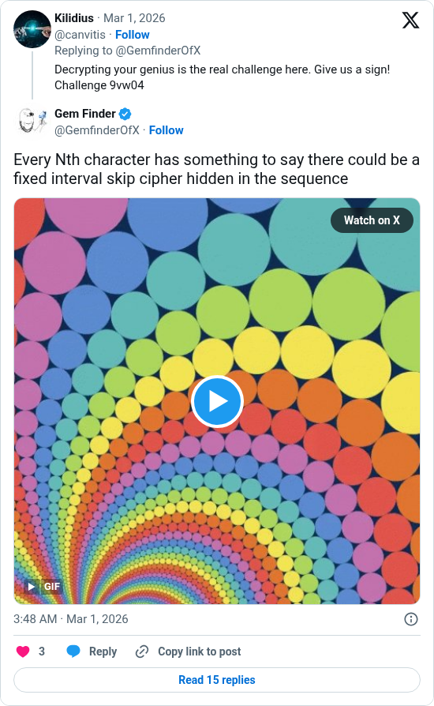

# Every Nth character

[Original post](https://x.com/GemfinderOfX/status/2027938957112279215). Cited by the [9vw04 record](../../../src/collections/9vw04.ts) for the skip cipher clue, posted fourteen months after the puzzle.

## Historical provenance

[Wayback capture from March 1, 2026, 02:48:19 UTC](https://web.archive.org/web/20260301024819/https://twitter.com/GemfinderOfX/status/2027938957112279215) is X's JSON payload for the post, taken the minute it went up, not a rendered page. Its `text` field carries the same wording as the transcript below, apart from the leading @canvitis mention and the t.co link X adds for the attachment.

## Transcript

> Every Nth character has something to say there could be a fixed interval skip cipher hidden in the sequence

## Screenshot

Rendered from X's public embed in a local headless Chromium, which is why it shows a Follow button and the post it answers above it. The displayed 3:48 AM timestamp is local to that browser (UTC+1). The frontmatter date is March 1 in UTC. The attached GIF, rainbow circles in a spiral, is kept only as rendered in the embed. Capture method and limits: [source archive](../README.md).
