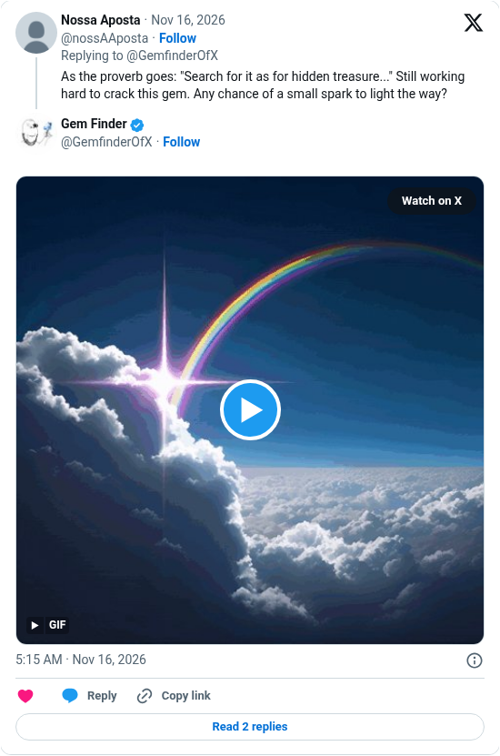

# A rainbow over the clouds

[Original post](https://x.com/GemfinderOfX/status/2122181658984284485). Cited by the [9vw04 record](../../../src/collections/9vw04.ts) as the GIF the author confirmed as a new hint.

## Historical provenance

No capture found. On November 27, 2026 the Wayback Machine index and the MemGator aggregator were searched for the `twitter.com` and `x.com` URL under both GemfinderOfX and IrrationalLibs, the name the account went by in January 2025. So the transcript below was checked against X's API text, the current post and the screenshot.

## Transcript

> [GIF](../../9vw04/rainbow.mp4)

## Screenshot

Rendered from X's public embed in a local headless Chromium, which is why it shows a Follow button and the request it answers above it. The displayed 5:15 AM timestamp is local to that browser (UTC+1). The frontmatter date is November 16 in UTC. The post has no text, only the GIF: a rainbow over a sea of clouds with a bright flare where it starts. The embed shows its first frame. The original file is the record's [rainbow.mp4](../../9vw04/rainbow.mp4), which X serves as a 4-second MP4. Capture method and limits: [source archive](../README.md).
