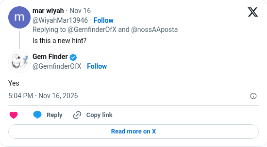

# Yes, a new hint

[Original post](https://x.com/GemfinderOfX/status/2122360200921550936). Cited by the [9vw04 record](../../../src/collections/9vw04.ts) for the one word that makes the rainbow GIF a hint.

## Historical provenance

No capture found. On November 27, 2026 the Wayback Machine index and the MemGator aggregator were searched for the `twitter.com` and `x.com` URL under both GemfinderOfX and IrrationalLibs, the name the account went by in January 2025. So the transcript below was checked against X's API text, the current post and the screenshot.

## Transcript

> Yes

## Screenshot

Rendered from X's public embed in a local headless Chromium, which is why it shows a Follow button and the question it answers above it. The displayed 5:04 PM timestamp is local to that browser (UTC+1). The frontmatter date is November 16 in UTC. The question, "Is this a new hint?", replies to the [rainbow GIF](gemfinderofx-2026-11-16-2122181658984284485.md). Capture method and limits: [source archive](../README.md).
