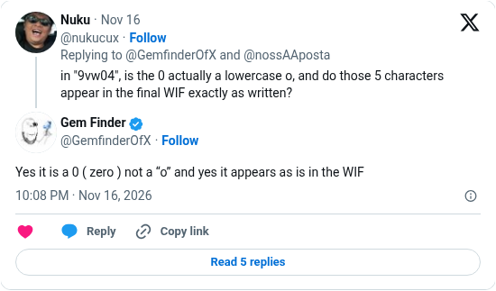

# A zero, not an o

[Original post](https://x.com/GemfinderOfX/status/2122436606015713739). Cited by the [9vw04 record](../../../src/collections/9vw04.ts) for the answer that the 0 in 9vw04 is a zero and sits in the WIF as is.

## Historical provenance

[Wayback capture from November 16, 2026, 21:08:14 UTC](https://web.archive.org/web/20261116210814/https://twitter.com/GemfinderOfX/status/2122436606015713739) is X's JSON payload for the post, taken the second it went up. Its `text` field carries the same wording as the transcript below, apart from the leading @nukucux and @nossAAposta mentions.

## Transcript

> Yes it is a 0 ( zero ) not a “o” and yes it appears as is in the WIF

## Screenshot

Rendered from X's public embed in a local headless Chromium, which is why it shows a Follow button and the question it answers above it. The displayed 10:08 PM timestamp is local to that browser (UTC+1). The frontmatter date is November 16 in UTC. Capture method and limits: [source archive](../README.md).
