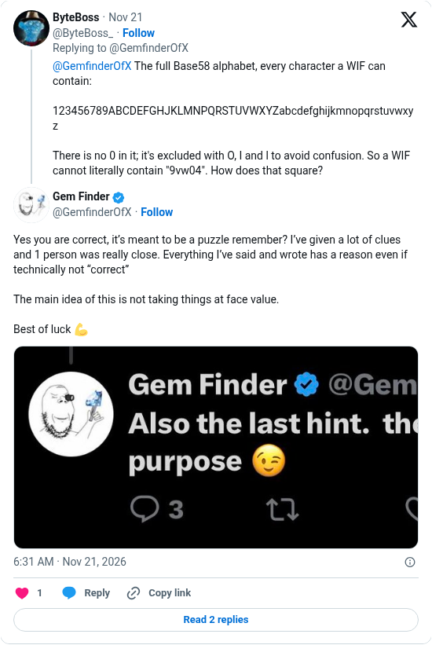

# Not taking things at face value

[Original post](https://x.com/GemfinderOfX/status/2124012727668748461). Cited by the [9vw04 record](../../../src/collections/9vw04.ts) for the reply to the point that Base58 has no zero.

## Historical provenance

No capture found. On November 27, 2026 the Wayback Machine index and the MemGator aggregator were searched for the `twitter.com` and `x.com` URL under both GemfinderOfX and IrrationalLibs, the name the account went by in January 2025. So the transcript below was checked against X's API text, the current post and the screenshot.

## Transcript

> Yes you are correct, it’s meant to be a puzzle remember? I’ve given a lot of clues and 1 person was really close. Everything I’ve said and wrote has a reason even if technically not “correct”
>
> The main idea of this is not taking things at face value.
>
> Best of luck 💪

## Screenshot

Rendered from X's public embed in a local headless Chromium, which is why it shows a Follow button and the question it answers above it. The displayed 6:31 AM timestamp is local to that browser (UTC+1). The frontmatter date is November 21 in UTC. The question spells out the Base58 alphabet and asks how a WIF can contain "9vw04". The attached image is a cropped screenshot of the author's own [January 13 note](gemfinderofx-2025-01-13-1878635172754788512.md) that the spelling is incorrect on purpose. Capture method and limits: [source archive](../README.md).
