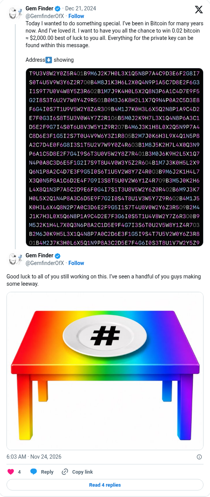

# A rainbow table with a hash on the plate

[Original post](https://x.com/GemfinderOfX/status/2125092863038124541). Cited by the [9vw04 record](../../../src/collections/9vw04.ts) for the picture posted under the puzzle in November 2026.

## Historical provenance

No capture found. On November 27, 2026 the Wayback Machine index and the MemGator aggregator were searched for the `twitter.com` and `x.com` URL under both GemfinderOfX and IrrationalLibs, the name the account went by in January 2025. So the transcript below was checked against X's API text, the current post and the screenshot.

## Transcript

> Good luck to all of you still working on this. I’ve seen a handful of you guys making some leeway.

## Screenshot

Rendered from X's public embed in a local headless Chromium, which is why it shows a Follow button and the puzzle post it answers above it. The displayed 6:03 AM timestamp is local to that browser (UTC+1). The frontmatter date is November 24 in UTC. The picture is a table painted in a rainbow gradient with a white plate and a black `#` on it. Its original upload is the record's [table.jpg](../../9vw04/table.jpg). Capture method and limits: [source archive](../README.md).
