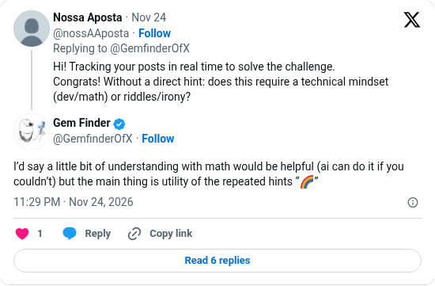

# The utility of the repeated rainbow hints

[Original post](https://x.com/GemfinderOfX/status/2125356189613781186). Cited by the [9vw04 record](../../../src/collections/9vw04.ts) for the answer that the rainbow hints matter more than the math.

## Historical provenance

No capture found. On November 27, 2026 the Wayback Machine index and the MemGator aggregator were searched for the `twitter.com` and `x.com` URL under both GemfinderOfX and IrrationalLibs, the name the account went by in January 2025. So the transcript below was checked against X's API text, the current post and the screenshot.

## Transcript

> I’d say a little bit of understanding with math would be helpful (ai can do it if you couldn’t) but the main thing is utility of the repeated hints “🌈”

## Screenshot

Rendered from X's public embed in a local headless Chromium, which is why it shows a Follow button and the question it answers above it. The displayed 11:29 PM timestamp is local to that browser (UTC+1). The frontmatter date is November 24 in UTC. The question asks whether the puzzle wants a technical mindset or riddles and irony. Capture method and limits: [source archive](../README.md).
