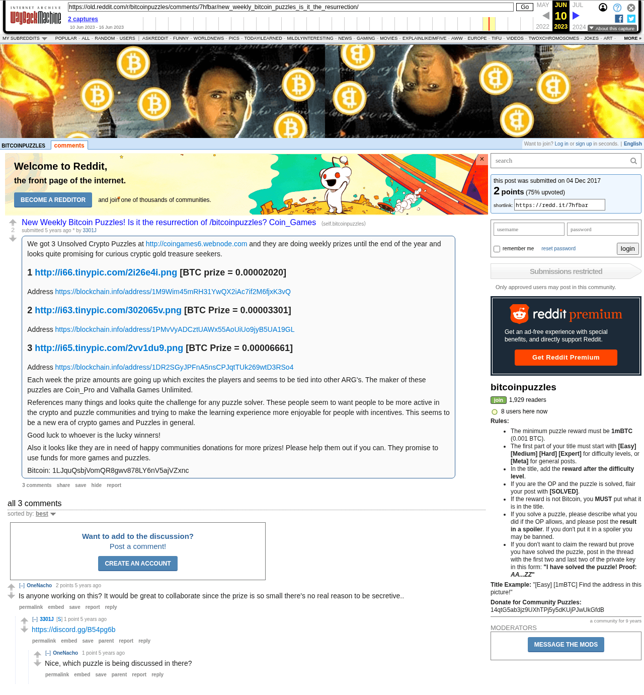

# New Weekly Bitcoin Puzzles! Is it the resurrection of /bitcoinpuzzles? Coin_Games

[Original thread](https://www.reddit.com/r/bitcoinpuzzles/comments/7hfbar/new_weekly_bitcoin_puzzles_is_it_the_resurrection/). The only place the three [coin-games](../../../src/collections/coin-games.ts) prizes ever got posted outside the Coin_Games site, and the source of the author fact that names Coin_Pro. It lists the first three images on Tinypic with their addresses and prizes, plus the donation address. Tinypic is gone, so the images in the records come from the site. The post went up on December 4, 2017, at 05:29:26 UTC, and was edited three minutes later.

It reads like a fan's tip ("they are doing weekly prizes"), but u/3301J also answered the one question in the comments with the Discord invite the Coin_Games home page links. Make of that what you will. The record doesn't merge the two names.

## Historical provenance

The Wayback Machine holds two captures each of the `www.reddit.com` and `old.reddit.com` URLs, all from June 2023. Provenance rests on the [old.reddit.com capture](https://web.archive.org/web/20230610010609/https://old.reddit.com/r/bitcoinpuzzles/comments/7hfbar/new_weekly_bitcoin_puzzles_is_it_the_resurrection/) of June 10, 2023, 01:06:09 UTC. Its HTML carries the post and the three comments the header counts, and they match the transcript below word for word. Old Reddit rendered the `#1`, `#2` and `#3` lines as headings, so the capture shows them without the `#`. It was read on October 13, 2026. `archive_content: confirmed` on that basis. The fourth comment came in May 2026, after the capture, and was already `[removed]`. archive.today had no capture of the thread on October 13, 2026.

The transcript takes the post and the comments from the [Arctic Shift](https://arctic-shift.photon-reddit.com/) Reddit archive, read on October 13, 2026. The [pullpush](https://pullpush.io/) Reddit archive, read the same day, gives the same post, time and edit, and the same four comments with the same authors, times, scores and parents.

## Transcript

> We got 3 Unsolved Crypto Puzzles at http://coingames6.webnode.com and they are doing weekly prizes until the end of the year and looks quite promising for curious cryptic gold treasure seekers.
>
> #1 http://i66.tinypic.com/2i26e4i.png [BTC prize = 0.00002020]
> Address https://blockchain.info/address/1M9Wim45mRH31YwQX2iAc7if2M6fjxK3vQ
>
> #2 http://i63.tinypic.com/302065v.png [BTC Prize = 0.00003301]
> Address https://blockchain.info/address/1PMvVyADCztUAWx55AoUiUo9jyB5UA19GL
>
> #3 http://i65.tinypic.com/2vv1du9.png [BTC Prize = 0.00006661]
> Address https://blockchain.info/address/1DR2SGyJPFnA5nsCPJqtTUk269wtD3RSo4
>
> Each week the prize amounts are going up which excites the players and seems to be tied into other ARG's. The maker of these puzzles are Coin_Pro and Valhalla Games Unlimited.
>
> References many things and looks quite the challenge for any puzzle solver. These people seem to want people to be more active in the crypto and puzzle communities and trying to make the learning experience more enjoyable for people with incentives. This seems to be a new era of crypto games and Puzzles in general.
>
> Good luck to whoever is the lucky winners!
>
> Also it looks like they are in need of happy communities donations for more prizes! Please help them out if you can. They promise to use funds for more games and puzzles.
>
> Bitcoin: 1LJquQsbjVomQR8gwv878LY6nV5ajVZxnc

## Comments

**u/OneNacho**, 2 points:

> Is anyone working on this? It would be great to collaborate since the prize is so small there's no real reason to be secretive..

**u/3301J**, 1 point, reply to u/OneNacho:

> https://discord.gg/B54pg6b

**u/OneNacho**, 1 point, reply to u/3301J:

> Nice, which puzzle is being discussed in there?

**[deleted]**:

> [removed]

## Screenshot

The screenshot is a render of the archive capture, not of the live page, so it carries the Wayback banner at the top. The "5 years ago" stamps are relative to the capture, June 10, 2023, and the removed 2026 comment isn't in it. Capture method and limits: [source archive](../README.md).
