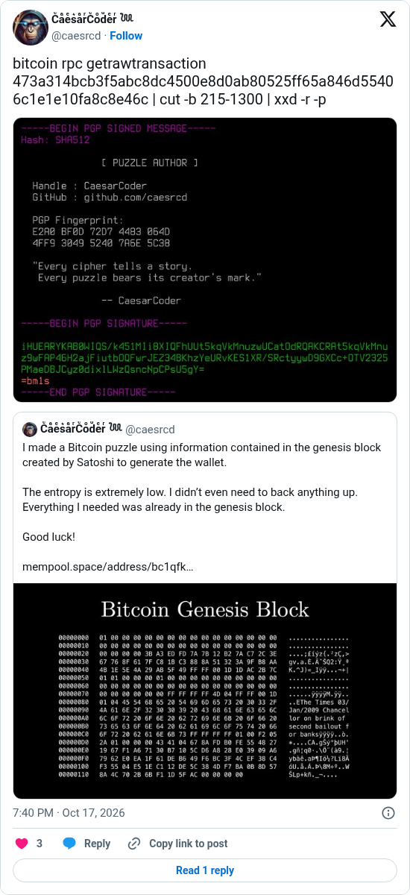

# The Genesis author signs

[Original post](https://x.com/caesrcd/status/2111512567294333206). Cited by the [genesis author record](../../../src/collections/genesis.ts). The post quotes the account's own [August 22 pre-announcement](caesrcd-2026-08-22.md), and the embed prints that quote below it. Only the cited post is transcribed.

## Historical provenance

No capture found. The Wayback Machine availability API was asked on October 19, 2026 for both the `twitter.com` and `x.com` URL and had no snapshot of either, so the transcript below was checked only against X's syndication JSON, the current embed and the screenshot.

## Transcript

> bitcoin rpc getrawtransaction 473a314bcb3f5abc8dc4500e8d0ab80525ff65a846d55406c1e1e10fa8c8e46c | cut -b 215-1300 | xxd -r -p

## Screenshot

The displayed 7:40 PM timestamp is local to the capture browser. The frontmatter date is October 17 in UTC, 17:40:00. The command decodes the `OP_RETURN` of [473a314b…](https://mempool.space/tx/473a314bcb3f5abc8dc4500e8d0ab80525ff65a846d55406c1e1e10fa8c8e46c), confirmed in block 971886 at 17:01:47 UTC and paid from the author's hint address, and the attached image shows its output: a PGP clearsigned message naming the handle CaesarCoder, github.com/caesrcd and the key fingerprint `E2A0 BF0D 72D7 4483 064D 4FF9 3049 5240 7A6E 5C38`. `gpg --verify` of those transaction bytes against the key served at github.com/caesrcd.gpg reports a good signature from subkey `BF93 8E75 3088 BC5C 8405 8545 2DE6 4A95 90C9 EECF`, checked on October 19, 2026. Capture method and limits: [source archive](../README.md).
