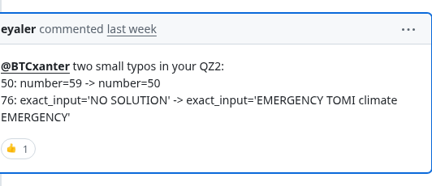

# Two small typos in a Quizchain2 script

[Original comment](https://github.com/floflo777/open-crypto-puzzles/pull/49#issuecomment-6542211466), posted by eyaler at 2026-10-31 10:25:59 UTC on pull request 49 of floflo777's open-crypto-puzzles repository. The source of the entropy and the answer in the [quizchain2/76](../../../src/collections/quizchain2/76.ts) record. BTCxanter attached a script to the same pull request on October 20. Its block 76 line read `NO SOLUTION`, and this comment corrects it to the full string. Neither of them swept the prize. That happened on August 17, 2026, and whoever did it never posted a word. This is a reproduction, and the claim's public key is what vouches for the string.

## Historical provenance

No capture found. On November 7, 2026 the Wayback Machine index listed three captures of the pull request page, October 20, 2026 at 13:13:30 and 13:14:15 UTC and October 22, 2026 at 20:18:15 UTC. All three predate the comment. The index has no capture under the comment's own URL either.

The screenshot is a headless Chromium render of the comment on the live pull request page, November 7, 2026. The viewport was 1012 pixels wide, with GitHub's sticky header hidden. The transcript comes from GitHub's REST API on the same day. The comment it answers is kept below for context. BTCxanter's attachment, `Quizchain_2_BLOCKS_1-77_FULL.py`, was downloaded the same day. Its block 76 line already carries `exact_input='EMERGENCY TOMI climate EMERGENCY'` by then, and the comment shows an edit at 2026-11-07 14:53:09 UTC.

## Transcript

> @BTCxanter two small typos in your QZ2:
> 50: number=59 -> number=50
> 76: exact_input='NO SOLUTION' -> exact_input='EMERGENCY TOMI climate EMERGENCY'

## The comment it answers

**BTCxanter**, 2026-10-20 19:05:38 UTC, last edited 2026-11-07 14:53:09 UTC, [comment](https://github.com/floflo777/open-crypto-puzzles/pull/49#issuecomment-6298926438):

> **complete, corrected solutions**
>
> [Quizchain_2_BLOCKS_1-77_FULL.py](https://github.com/user-attachments/files/34521713/Quizchain_2_BLOCKS_1-77_FULL.py)
> [Quizchain_1_BLOCKS_1-77_FULL.py](https://github.com/user-attachments/files/34521716/Quizchain_1_BLOCKS_1-77_FULL.py)
