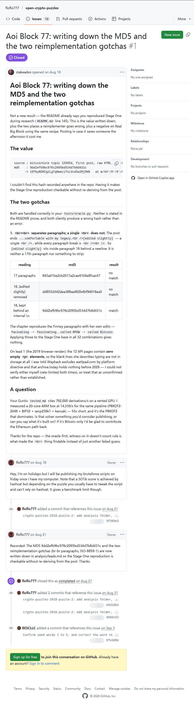

# Aoi Block 77: writing down the MD5 and the two reimplementation gotchas

[Original issue](https://github.com/floflo777/open-crypto-puzzles/issues/1), opened by stakeados in floflo777's open-crypto-puzzles repository at 2026-08-18 01:58:00 UTC and closed by floflo777 on August 21. The source of the entropy in the [quizchain2/77](../../../src/collections/quizchain2/77.ts) record. Neither of them won the block: u/puzzleponky claimed it on August 3, 2019 and kept the method. This is a reproduction seven years later, and the claim's public key is what vouches for the hash. The issue has two comments, both below.

## Historical provenance

The Wayback Machine holds two captures of the issue, [September 22, 2026](https://web.archive.org/web/20260922133556/https://github.com/floflo777/open-crypto-puzzles/issues/1) and October 13, 2026. The `id_` body of the September 22 capture was read on October 13, 2026: it carries the title, the whole issue body with the MD5 and the address, and both comments. `archive_content: confirmed` on that basis.

The screenshot is a headless Chromium render of the live issue's `main` element on October 13, 2026, 784 pixels wide. The transcript comes from GitHub's REST API on the same day. The issue body was pasted as HTML, so the transcript renders it as Markdown, with the text, code and table cells unchanged.



## Transcript

> # Aoi Block 77: writing down the MD5 and the two reimplementation gotchas
>
> Not a new result — the README already says you reproduced Stage One during research (`README.md` line 145). This is the value written down, plus the two places a reimplementer goes wrong, plus a negative on Real Big Block using the same recipe. Posting in case it saves someone the afternoon it cost me.
>
> ## The value
>
> ```
> source : bitcointalk topic 155054, first post, raw HTML (ISO-8859-1, ASCII body)
> md5    : 9dd2efb9bc976c2095bd534d7b8d431c
>       -> 19TbyN5KCg1Lg7qHwezifsLVcdSa2Rj5KN   at m/44'/0'/0'/0/0
> ```
>
> I couldn't find this hash recorded anywhere in the repo. Having it makes the Stage One reproduction checkable without re-deriving from the post.
>
> ## The two gotchas
>
> Both are handled correctly in your `tools/oracle.py`. Neither is stated in the README prose, and both silently produce a wrong hash rather than an error.
>
> **1. `<br><br>` separates paragraphs; a single `<br>` does not.** The post ends `...comfortable with my legacy.<br />[edited slightly]` — a _single_ `<br />`, while every paragraph break is `<br /><br />`. So `[edited slightly]` sits inside paragraph 16 behind a newline. It is neither a 17th paragraph nor something to strip:
>
> | reading                        | md5                              | result   |
> | ------------------------------ | -------------------------------- | -------- |
> | 17 paragraphs                  | 845a41be2cb2017a2cae9104e8fcac47 | no match |
> | 16, [edited slightly] removed  | dd855d342dea388aa902b4bf94016ea5 | no match |
> | 16, kept behind an internal \n | 9dd2efb9bc976c2095bd534d7b8d431c | match    |
>
> The chapter reproduces the Finney paragraphs with her own edits — `facinating` -> `fascinating`, `called RPOW` -> `called Bitcoin`. Applying those to the Stage One base in all 32 combinations gives nothing.
>
> On lead 1 (the 2019 browser render): the 12 API pages contain **zero empty `<p>` elements**, so the blank lines she describes typing are not in storage at all. I was told Wayback excludes wattpad.com by platform directive and that archive.today holds nothing before 2026 — I could not verify either myself (rate-limited both times), so treat that as unconfirmed rather than established.
>
> ## A question
>
> Your Guntis `tested.md` cites 792,000 derivations/s on a rented GPU. I measured a 20-core ARM box at 14,339/s for the same pipeline (PBKDF2-2048 + BIP32 + secp256k1 + keccak) — 55x short, and it's the PBKDF2 that dominates. Is that solver something you'd consider publishing, or can you say what it's built on? If it's Bitcoin-only I'd be glad to contribute the Ethereum path back.
>
> Thanks for the repo — the oracle-first, witness-or-it-doesn't-count rule is what made the `<br>` thing findable instead of just another failed guess.

## Comments

Both comments, oldest first.

**floflo777**, 2026-08-18 13:19:41 UTC, [comment](https://github.com/floflo777/open-crypto-puzzles/issues/1#issuecomment-5328743967):

> Hey, I’m on holidays but I will be publishing my bruteforce scripts on friday once I have my computer. Note that a SOTA score is achieved by hashcat but depending on the puzzle you usually have to tweak the script and can’t rely on hashcat. It gives a benchmark limit though.

**floflo777**, 2026-08-21 16:04:03 UTC, [comment](https://github.com/floflo777/open-crypto-puzzles/issues/1#issuecomment-5372278399):

> Recorded. The MD5 9dd2efb9bc976c2095bd534d7b8d431c and the two reimplementation gotchas (br-br paragraphs, ISO-8859-1) are now written down in analysis/leads.md so the Stage One reproduction is checkable without re-deriving from the post. Thanks.
