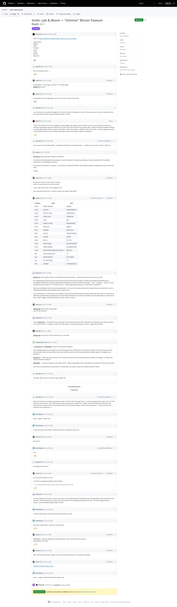

# Smith, Lyle & Moore — "Glimmer" Bitcoin Treasure Hunt

[Original](https://github.com/floflo777/open-crypto-puzzles/issues/41#issuecomment-6333713021). Wayback's [October 27 capture](https://web.archive.org/web/20261027131059/https://github.com/floflo777/open-crypto-puzzles/issues/41) shows Schum's solution and the link to the write-up. It hides 33 other comments behind a load button.

The screenshot is a Steel render of the live issue. The transcript comes from GitHub's REST API. The thread screenshot leaves collapsed comments hidden; the transcript includes all 62 comments.

## Transcript

> # Smith, Lyle & Moore — "Glimmer" Bitcoin Treasure Hunt

### Issue by BTCxanter, 2026-10-06T10:21:00Z

> more hint https://pdfhost.io/v/j8y6cN2WSx_smith_lyle_moore_findings
>
> South branch
> Gilligan
> Jonas
> Thurston
> Lovey
> Ginge
> Dr. Roy
> Mary Ann

### deviceio121, 2026-10-06T19:08:00Z

> this is all already known... :)

### Schum-io, 2026-10-18T11:21:50Z

> /pirate-battle = `fire cannon` and then 777 to death page
> @floflo777 add this

### Schum-io, 2026-10-18T11:23:28Z

> I’ve opened up every single page, but I’m not yet sure I want to share them.

### deviceio121, 2026-10-18T18:49:19Z

> out of curiosity, if you opened all pages, I think you did. what is holding you to solve it? Did you sent your words to codebraker and eat some weiners? I have opened 3 bottles missing 1 I think.

### floflo777, 2026-10-18T19:08:50Z

> Thanks. The character list reads as Gilligan's Island (Gilligan, the Skipper Jonas Grumby, Thurston and Lovey Howell, Ginger, the Professor Roy Hinkley, Mary Ann), which fits the Smith Lyle & Moore style of pop-culture gates. I will go through the pdfhost findings and fold anything that checks out against the folder's oracle into analysis/, credited. If any of it resolves a concrete page password or a seed fragment, post the exact string and the page it opens and it goes straight into tested.md.

### deviceio121, 2026-10-18T19:18:16Z

> can you post urls like /pirate-battle.... etc what you did open? no passwords just /.... maybe we are not far to solve it. thank you

### yesoxx, 2026-10-18T22:06:16Z

> @Schum-io Hey, impressive progress on Glimmer!
>
> You mentioned having opened every page. I'm curious whether the remaining challenge is understanding the final assembly instructions or something else entirely.
>
> Not asking for passwords or solutions — just trying to understand whether opening all the pages actually gets you close to the final solve.
>
> Thanks!

### Schum-io, 2026-10-19T04:46:30Z

> By the end, we know 10 out of the 12 words,
> and all 12 words need to be sent via email.
>
> I sent a few versions, but no one replied to me.
>
> also i have been brute force 12 words on gpu, but it doesn't take effect

### Schum-io, 2026-10-19T05:19:28Z

> | compass | page                             | pass              |
> | ------- | -------------------------------- | ----------------- |
> | North   | `/whale-message`                 | `glimmer`         |
> | North   | `/land-ho`                       | `huntgathwhalblo` |
> | North   | `/hitch-a-ride`                  | `seahitchhiker`   |
> | North   | `/reach-land`                    | `sleighride`      |
> | North   | `/hell`                          | `666`             |
> | North   | `/swim-to-shore`                 | `michaelphelps`   |
> | North   | `/cape-cod`                      | `vampire`         |
> | West    | `/message`                       | `pirate bay`      |
> | West    | `/ross-u`                        | `shiphuntshalpar` |
> | West    | `/escape`                        | `escape`          |
> | South   | Name 6                           | `Dr. Roy`         |
> | South   | `/raft-escape`                   | `gilligansisland` |
> | South   | `/smoke-signals`                 | `gilligansisland` |
> | South   | `/hereonnnnngiligansissssssland` | `Mary Ann`        |
> | East    | `/take-a-big-breath`             | `***`             |
> | East    | `/pirate-battle`                 | `fire cannon`     |
> | East    | `/a-rocky-beach`                 | `***`             |
> | East    | `/glimmer`                       | `closerandcloser` |

### Neopram, 2026-10-19T06:14:04Z

> @Schum-io You’ve gotten further on the Glimmer hunt than anyone — thank you for sharing as much as you did.
>
> I’ve independently reopened most of the site and confirmed the three message-in-a-bottle words (ship/hunt/shallow/parrot, hunt/gather/whale/blood, when/you/depart/find/mystery), plus the vault chain (the-passage → vault → gateway → ticket). I’m stuck exactly where your table has ***: the East branch — take-a-big-breath (resurface), a-rocky-beach, and glimmer.
>
> Would you be willing to share those three passwords, or even just a hint about what kind of answer they are (a movie line? a lyric? a single word)? And the order you believe the 12 words go in?
>
> You mentioned the 12 words have to be emailed to the band and nobody replied, and that a GPU brute-force didn’t hit. That lines up with there possibly being a passphrase or the hunt being unfinished on the author’s side (the cape-cod page still says “Coming Soon · Sep 9, 2022”). Happy to pool everything I’ve found in return. Cheers!!

### Schum-io, 2026-10-19T07:27:24Z

> @Neopram hint for /take-a-big-breath
> pass format: twoword

### Neopram, 2026-10-19T08:50:59Z

> Thanks @Schum-io — the path info was a big help. The two-word answer for /take-a-big-breath is still beating me after the obvious tries. If you’re up for it, a nudge on either word (first letter or theme) would get me unstuck....appreciate the help!

### hoho087, 2026-10-19T09:30:00Z

> @Neopram I found it too, here's another hint. In the video

### dobispreneur-hue, 2026-10-19T14:46:17Z

> Hi @Schum-io and @hoho087, thanks for sharing your progress.
>
> We've independently reconstructed much of the Wix puzzle and confirmed the numbered word tables. The remaining issue is the final extraction: there are two different #5 entries, while #9 and #12 don't have standalone numbered labels in the pages we've examined.
>
> @Schum-io — When you say you know 10 of 12 words, are these the ten numbered positions visible on the pages, or did you find another extraction method?
>
> @hoho087 — Could you expand on your video hint for `/take-a-big-breath`? Even a timestamp or the type of visual clue would help.
>
> No need to reveal passwords, seed words, or private keys. Just trying to verify the intended method. Thanks!

### deviceio121, 2026-10-19T14:55:27Z

> one what i didn't solve is /treasure-map-97328971321

### Schum-io, 2026-10-19T15:10:47Z

> treasure-map-97328971321 is for first hunt, not for second

### Schum-io, 2026-10-19T15:15:38Z

> @dobispreneur-hue
> /take-a-big-breath open 5,6,7,8 words
> /a-rocky-beach open 10,11 word
>
> words 9,12 I chose it based on the context, but I’m not entirely sure.

### deviceio121, 2026-10-19T15:28:36Z

> while ago i have submitted wrong words, received reply, but not sure if they are still replying. anyway now when /glimmer is opened publicly they will be spammed i think :D

### Schum-io, 2026-10-19T15:42:41Z

> I sent them 5 emails, and I didn’t get a response to any of them.

### deviceio121, 2026-10-19T18:07:44Z

> the problem is if they will not respond to mails, its almost imposible to bruteforce passphrase even with all mnemonic words.
> their reply was something like you lost, here are some weiners or something like that if I remember correctly. and attached some image with hotdog. the problem was when I was sending that mail I had solved /glimmer, and didn't have /take-a-big-breath and /a-rocky-beach
> I think they are pissed people using AI for solving it and stopped responding maybe. But i don't think /take-a-big-breath can solve AI, or maybe by accident, with all those hallucinations.

### DevinDking, 2026-10-20T04:44:38Z

> @deviceio121 can you forward that email to devinboss11@gmail.com ?

### Schum-io, 2026-10-20T06:50:12Z

> Today I sent them an email to codebreaker@smithlylemoore.com:
>
> - Hey guys, are you still around? I’d like to know if the puzzle is still active.
>
> They replied from [info@smithlylemoore.com](mailto:info@smithlylemoore.com):
>
> - No
>   Sent from my iPhone

### deviceio121, 2026-10-20T06:53:11Z

> @Schum-io thank you for info I sent the mail 2 days ago with words and no response, so it seems its over.

### DevinDking, 2026-10-20T13:31:35Z

> What do they mean no? bro....

### yesoxx, 2026-10-20T13:49:04Z

> wait.. does that mean the puzzle is over ?

### deviceio121, 2026-10-20T14:36:14Z

> if you will not get reply from them, seems like yes, its over. with no passphrase its lottery
> @DevinDking "Hey guy! You lost! But here’s a consolation weiner!!!" and attachment of .heic file, nothing you can use to solve it. Now its about selecting 2 missing words from and sending it to codebraker, seems like they will not respond anymore, so if you think you have 12 mnemonic words, you can bruteforce passphrase, what i tried, but no luck. I have 12 words based on context as @Schum-io mentioned. Schum said he sent 5 mails formatted as it have to be, and no reply, seems to me they are chery picking who will they respond and who not. First of all it's their logic of puzzle to respond to latest stage, and it seems they decided its over. If you quess the words by context you have 1 valid checksum and one which is not logical but fits bottle word. Then you have lot of options and its unsolvable at that state. If they will not respond to me or anyone in one week, i will post my findings here. We have invested enough time to solving this... I will not be surprised if the wallet will be emptied and they will claim, someone solved it in coming days...
>
> 

### DevinDking, 2026-10-20T19:54:55Z

> Opened all pages now - the fact that there is no "9" or "12" is frustrating. Will try an email and pray for the best!

### BTCxanter, 2026-10-21T07:55:09Z

> > 8\. know 10 out of the 12 words
>
> Could you share this with the community?

### deviceio121, 2026-10-21T08:09:21Z

> > Today I sent them an email to [codebreaker@smithlylemoore.com](mailto:codebreaker@smithlylemoore.com):
> >
> > - Hey guys, are you still around? I’d like to know if the puzzle is still active.
> >
> > They replied from [info@smithlylemoore.com](mailto:info@smithlylemoore.com):
> >
> > - No
> >   Sent from my iPhone
>
> <- Anyone received any reply other than this ?

### DevinDking, 2026-10-21T15:12:48Z

> Thank you Mr. AI

### Schum-io, 2026-10-21T15:25:20Z

> > 30\. Thank you Mr. AI
>
> Are you okay?

### DevinDking, 2026-10-21T15:27:39Z

> ok he deleted his comment now i look bad

### DevinDking, 2026-10-21T15:28:03Z

> 

### s-xander, 2026-10-21T15:49:19Z

> My bad, my dumb bot posted that without my permission :D

### deviceio121, 2026-10-21T15:51:07Z

> rocky beach you don't need bot to solve it it's pretty obvious

### DevinDking, 2026-10-21T15:58:18Z

> Do we know if in hunt 1 they left out any words?

### graybyrd13, 2026-10-21T16:27:40Z

> > 30\. rocky beach you don't need bot to solve it it's pretty obvious
>
> Can you provide a hint?

### deviceio121, 2026-10-21T16:40:15Z

> you have pass for take a big breath in screenshot above, you have hint there. Guys I'm realy sad that this Treasure Hunt puzzle ended like this, it was great puzzle. :/

### deviceio121, 2026-10-21T16:49:22Z

> Atlas Mountains

### Schum-io, 2026-10-21T17:03:48Z

> All the rooms are open now; if anyone gets a reply via email, please let me know.

### deviceio121, 2026-10-21T17:10:47Z

> > 32\. All the rooms are open now; if anyone gets a reply via email, please let me know.
>
> same, but i don't think we will get reply. I have the last 2 words based on their hints, tried to bruteforce passphrase but no luck.
> @Schum-io when you use 12 mnemonic words maybe we have same adress with no passphrase, based on hints/logic: bc1q0ezn58t3kdrx0973ycmseah99hzancqse4fwql
> actualy its only one with valid checksum, from hints
> its just sad, how this ended even with 12 mnemonic words we cant solve it. Someone with gpu farm will bruteforce it.

### DevinDking, 2026-10-21T17:18:17Z

> So annoying they said no but wont answer any other email...

### Schum-io, 2026-10-21T17:25:09Z

> >      its just sad, how this ended even with 12 mnemonic words we cant solve it. Someone with gpu farm will bruteforce it.
>
> The 9th word is the same, but my 12th word is different :)
>
> I did try a whole bunch of options, though.

### deviceio121, 2026-10-21T17:29:21Z

> > 32\. > `     >  its just sad, how this ended even with 12 mnemonic words we cant solve it. Someone with gpu farm will bruteforce it.
     >`
> >
> >      The 9th word is the same, but my 12th word is different :)
> >      I did try a whole bunch of options, though.
>
> why there is only 1 valid checksum from bottle, do you want me write that word?

### Schum-io, 2026-10-21T17:38:54Z

> For 11 words, there are 128 possible variations for the 12th word (which acts as a checksum).

### deviceio121, 2026-10-21T17:39:27Z

> depart is one of them and in the bottle, only one
> "They've all been from her... All of the messages... She still loves you."

### Schum-io, 2026-10-21T17:43:24Z

> Agreed, but they still aren’t responding to our emails, and it’s unclear what’s left to do—whether it’s figuring out the password or some other step.

### deviceio121, 2026-10-21T17:46:04Z

> > 34\. Agreed, but they still aren’t responding to our emails, and it’s unclear what’s left to do—whether it’s figuring out the password or some other step.
>
> they will not respond, they are pissed, people shared passwords on reddit on their reddit, and they are pissed that people used AI
> before I sent them 2 mails, formatted as glimmer said so, they responded in 1 day(codebraker), sent 3rd no response. its like 1 month ago

### deviceio121, 2026-10-21T17:52:44Z

> whats left, we have is bruteforce passphrase, what i tried but i don't have gpu farm :D , I was just enjoying the puzzle, its not our fault someone have big "ego". If you didn't get that response what you received "No", maybe i could think they have some work and haven't time to respond. But You did and thank you for that, that you shared it. Best of luck to everyone :) . I hope someone will bruteforce the passphrase. :D

### DevinDking, 2026-10-22T02:05:34Z

> Great - wallet is empty lmao

### DevinDking, 2026-10-22T02:06:15Z

> So did someone hit the lottery or did the band take it days after saying "no"...

### Schum-io, 2026-10-22T02:36:10Z

> who wins?

### DevinDking, 2026-10-22T02:44:17Z

> Not I

### deviceio121, 2026-10-22T04:01:45Z

> Mr big Ego took it back :)

### Schum-io, 2026-10-22T04:04:13Z

> Do you think the author took it?
>
> I sent him a message yesterday, and he replied.
>
> > If u cared about solving it, you wouldn’t be farming it out to AI!

### Neopram, 2026-10-22T04:19:13Z

> Of course people are using AI….Doctors are using it, and mathematicians and physicists are solving problems that would have taken centuries... What kind of excuse is that not to pay 0.03 BTC? We are talking about $2,500 at most... The band simply needs the money... that's how badly things will go for them!

### DevinDking, 2026-10-22T04:25:59Z

> I doubt someone got it, and they seemed pretty pissy as of late...

### DevinDking, 2026-10-22T04:26:28Z

> But that's all speculation, someone could've had it

### Schum-io, 2026-10-22T05:45:18Z

> MNEMONIC : when you depart find mystery discover music need love fortune safe sea
> PASSPHRASE : immortal

### Schum-io, 2026-10-22T05:50:47Z

> Well, I did try that mnemonic option, but with 576 other passwords at 17 october. well played

### Schum-io, 2026-10-22T06:07:04Z

> [WRITEUP_PUBLIC_STORY_EN.md](https://github.com/user-attachments/files/33803089/WRITEUP_PUBLIC_STORY_EN.md)

### DevinDking, 2026-10-22T13:36:53Z

> damn - congrats. Glad the band didn't steal it lmao
