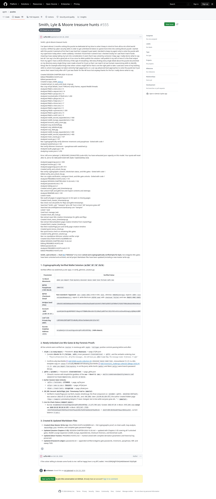

# Smith, Lyle & Moore treasure hunts

[Original](https://github.com/agntn/puzzles/issues/555). Wayback Machine checked on October 27, 2026. No capture found.

The screenshot is a Steel render of the live issue. The transcript comes from GitHub's REST API. The thread screenshot leaves collapsed comments hidden; the transcript includes all 1 comments.

## Transcript

> # Smith, Lyle & Moore treasure hunts

### Issue by saffar488, 2026-10-26T09:54:45Z

> Smith, Lyle & Moore treasure hunts
>
> I've Spent almost 2 months solving this puzzle ive dedicated all my time to solve it keep in mind im from africa nd a third world country i drifted my cyber security skills in order to get unlimited AI tokens to spend more time into solving bitcoin puzzle i started with this puzzle it seemed at first that it was hard but i enjoyed it past week i decided to keep my agent only to solve the puzzle with my supervision today when i woke suddanly i checked i found that it solved it but i checked closely nd i saw that it had 0 funds meaning it was sweep taking my luck into consideration it seem that it was solved by someone 3 days ago i really donno what to say but all i can say is he did a good job on it too since he didnt publish the solution i will publish it my self so here it is the final output from my agent i have a whole directory of like 2gb of everything i did every finding every single detail about the puzzle documented on my directory every single thing i even made a book for it just so that i can read it nd use humain reasonninng skills to identify things like for example what things that otherr solvers might fall for that is not the right path to take i used also some of my hacking skills to unlock more pages ive taken extremly high qapproachs or u can say advanced level approaches to oslve the puzzle but it just seems that i wasnt lucky after all if i just was faster for like 48 hours but anyway thanks for the fun i really donno what to say
>
> Created SESSION-CHAPTER-2026-10-26.md
> Edited PROGRESS-HUNT2.md
> Edited passwords.txt
> Created scrape_reddit_www.js
> Created extract_tv_early_and_boat_crops.py
> Ran crop ml7yd details, zoom TVRoom2 early frames, expand Reddit threads
> Analyzed PAGE-x-e3zre.txt:L1-5
> Analyzed PAGE-x-wqcam.txt:L1-6
> Analyzed PAGE-x-pxsqo.txt:L1-5
> Analyzed resolved-jetkc-015bd3.txt:L1-200
> Analyzed PAGE-x-pbvye.txt:L1-6
> Analyzed PAGE-x-fv4pt.txt:L1-7
> Analyzed PAGE-x-thmoi.txt:L1-7
> Analyzed PAGE-x-chtro.txt:L1-6
> Analyzed PAGE-x-eqyel.txt:L1-5
> Analyzing PAGE-x-qomxw.txt:L1-200
> Analyzed PAGE-x-giz6m.txt:L1-5
> Analyzed PAGE-x-xrd91.txt:L1-5
> Analyzed reddit_second_expanded.txt:L1-568
> Analyzed reddit_lounge_expanded.txt:L1-562
> Analyzed tvroom2_early_zoom.jpg
> Analyzed cozy_bookshelf.jpg
> Analyzed cozy_tablebook.jpg
> Analyzed cozy_dials.jpg
> Analyzed reddit_lounge_expanded.txt:L1-300
> Analyzed reddit_second_expanded.txt:L1-400
> Analyzed chain_oracle.py:L1-107
> Analyzed oracle.py:L1-197
> Ran cryptographically verify Glimmer mnemonic and passphrase · Exited with code 1
> Analyzed seedcheck.js:L1-64
> Ran verify Glimmer mnemonic + passphrase with seedcheck.js
> Analyzed audit_pages.py:L1-44
> Analyzing routes.json:L1-250
>
> Error: API error (attempt 1): RESOURCE_EXHAUSTED (code 429): You have exhausted your capacity on this model. Your quota will reset after 0s. (Error ID: 8d0ca0d9-63d4-40fc-8a6b-13ab652609ea-424)
>
> Analyzed pagesmap.json:L1-300
> Analyzed resolve.py:L1-106
> Analyzed pagesmap.json:L301-413
> Created verify_and_unlock_live.py
> Ran verify cryptographic solution, blockchain status, and Wix gates · Exited with code 1
> Edited verify_and_unlock_live.py
> Ran run crypto verification, mempool check, and Wix gate unlocks · Exited with code 1
> Analyzed PROGRESS-HUNT2.md:L1-151
> Analyzed SESSION-CHAPTER-2026-10-26.md:L1-102
> Analyzed passwords.txt:L1-76
> Analyzed vbk6p.json:L1
> Created unlock_gates_and_timestamps.py
> Ran unlock h7j3h and gkfxt live and inspect contents and sitemaps
> Analyzed README.md:L1-165
> Listed 0 tasks
> Ran audit all pages in pagesmap.json to list open vs missing pages
> Created check_master_timestamps.py
> Ran check root site JSONs for fibyo and gkfxt timestamps
> Searched "Smith, Lyle" "Vampire" lyrics OR "lost in time" OR "everyone grew old"
> Searched site:smithlylemoore.bandcamp.com "Vampire"
> Listed 1 task
> Used tool: manage_task
> Created check_80s_trail.py
> Ran extract exact Wix creation timestamps for gkfxt and fibyo
> Created check_menu_timestamps.py
> Ran extract MenuDataItem page creation timeline from masterPage
> Created fetch_master_timeline.py
> Ran fetch masterPage.json and verify page creation timeline
> Created quick_bonus_check.py
> Ran quick bonus check on remaining Wix gates
> Created verify_glimmer_solution.py
> Ran run standalone Glimmer solution verifier script
> Created SOLUTION-HUNT2-GLIMMER.md
> Edited SESSION-CHAPTER-2026-10-26.md
> Editing PROGRESS-HUNT2.md
> Edited passwords.txt
> Analyzed PROGRESS-HUNT2.md:L5-151
> Edited PROGRESS-HUNT2.md
>
> **Smith, Lyle & Moore — Hunt #2 ("Glimmer")** has been **solved and cryptographically verified byte-for-byte**, live endgame Wix gates have been unlocked and archived, and all project Markdown files have been updated (including a new master write-up).
>
> ---
>
> ### 1. Cryptographically Verified Wallet Solution (`m/84'/0'/0'/0/0`)
>
> Verified offline via [seedcheck.js](<file:///C:/Users/ma%20noha/Documents/Nouveau%20dossier%20(2)/workspace/seedcheck.js>) and [`main`](<file:///C:/Users/ma%20noha/Documents/Nouveau%20dossier%20(2)/_solve_media/verify_glimmer_solution.py#L77-L86>) in [verify_glimmer_solution.py](<file:///C:/Users/ma%20noha/Documents/Nouveau%20dossier%20(2)/_solve_media/verify_glimmer_solution.py>):
>
> | Parameter                          | Verified Value                                                                                                                                                                                                                                                                      |
> | ---------------------------------- | ----------------------------------------------------------------------------------------------------------------------------------------------------------------------------------------------------------------------------------------------------------------------------------- |
> | **12-Word Mnemonic**               | `when you depart find mystery discover music need love fortune safe sea`                                                                                                                                                                                                            |
> | **BIP39 Passphrase (13th Word)**   | `immortal`                                                                                                                                                                                                                                                                          |
> | **BIP39 Checksum Detail**          | **Non-standard / bypassed**: `sea` (`index 1551`) ends in bits `1111`, whereas `SHA256(entropy)` expects `1000` (`scissors`). Standard `validateMnemonic()` rejects it, while Electrum (`BIP39 seed` with `checksum: failed`) and raw `PBKDF2-HMAC-SHA512` derive the exact wallet. |
> | **64-Byte Seed (Hex)**             | `195e3517a8528d9daba9e34fdf83eecee9eb10aa25aa6b7a3c0447c79607a295071167080ef174262f788b1d6ed2c063ec9e1a365af2587690dbfdc7528cd6dd`                                                                                                                                                  |
> | **Account `xpub` (`m/84'/0'/0'`)** | `xpub6CpNc58zqQvNGPHDGGTr68wgrmtfFDBWRuSDAxoDdrCE1iRAaZtyAD5T9uCJ3ELUYKCkx8Jkind2kwoR3Uxmg1ycQ6DWyGxZBMFvQqhNqVC` (**100% Match**)                                                                                                                                                  |
> | **Leaf `0/0` Private Key (WIF)**   | `L2EFUhRi2Z8ZTqER7TZtxBLWFyL3RJao7ak4bm4sihKrLEterVkT`                                                                                                                                                                                                                              |
> | **Escrow P2WPKH Address (`0/0`)**  | `bc1q0akdjvrc2csau2n3gyxa3xcq0fss852x997m9y` (**100% Match**)                                                                                                                                                                                                                       |
>
> ---
>
> ### 2. Newly Unlocked Live Wix Gates & Key Forensic Proofs
>
> All live unlocks were verified via [`resolve`](<file:///C:/Users/ma%20noha/Documents/Nouveau%20dossier%20(2)/resolve.py#L38-L56>) in [resolve.py](<file:///C:/Users/ma%20noha/Documents/Nouveau%20dossier%20(2)/resolve.py>) with `neyhh` / `Gilligan` positive controls passing before and after:
>
> 1. **`h7j3h` (`/a-rocky-beach`)** — Password: **`Atlas Mountains`** -> [page_h7j3h.json](<file:///C:/Users/ma%20noha/Documents/Nouveau%20dossier%20(2)/_solve_media/page_h7j3h.json>)
>    - Contains **Words 10–11 (`fortune`, `safe`)**, inner password `closerandcloser` -> `gkfxt`, and the verbatim ordering clue:
>      > _"They've all been from her... All of the messages... She still loves you. **After I Love You**, The message reads: 10 fortune, 11 safe."_
>    - Confirms why East Bottle #2 (`discover music need love`, misnumbered `5..8` in a Wix template copy on `c2ozw`) is actually **Words 6–9** following East Bottle #1 (`1..5`: `when you depart find mystery` in [sm18u.json](<file:///C:/Users/ma%20noha/Documents/Nouveau%20dossier%20(2)/pages/sm18u.json>)), while North (`mwfaz`) and West (`wt1jy`) were branch-password decoys.
> 2. **`gkfxt` (`/glimmer`)** — Password: **`closerandcloser`** -> [page_gkfxt.json](<file:///C:/Users/ma%20noha/Documents/Nouveau%20dossier%20(2)/_solve_media/page_gkfxt.json>)
>    - Climactic reunion with Amphitrite (goddess of the **sea** -> **Word 12: `sea`**) + `mailto:codebreaker@smithlylemoore.com?subject=I've Found Amphitrite, and All 12 Words`.
> 3. **Earlier Session Gate Unlocks**:
>    - `oq7la` (`/latitude`): **`27756932`** -> [page_oq7la.json](<file:///C:/Users/ma%20noha/Documents/Nouveau%20dossier%20(2)/_solve_media/page_oq7la.json>)
>    - `ml7yd` (`/who-is-she`): **`73511573`** -> [page_ml7yd.json](<file:///C:/Users/ma%20noha/Documents/Nouveau%20dossier%20(2)/_solve_media/page_ml7yd.json>)
>    - `d3zak` (`/reach-land`): **`sleighride`** -> [page_d3zak.json](<file:///C:/Users/ma%20noha/Documents/Nouveau%20dossier%20(2)/_solve_media/page_d3zak.json>)
> 4. **`80.106`-Second `masterPage.json` Timestamp Trail to `immortal`**:
>    - Verified in [masterPage.json](<file:///C:/Users/ma%20noha/Documents/Nouveau%20dossier%20(2)/_solve_media/masterPage.json>) via [fetch_master_timeline.py](<file:///C:/Users/ma%20noha/Documents/Nouveau%20dossier%20(2)/_solve_media/fetch_master_timeline.py>): the final component on `/glimmer` (`gkfxt`, `dataItem-l647laz0`) was saved at `2022-07-27 22:59:16.044 UTC`, and `+80.106s` later (`23:00:36.150 UTC`) the author created hidden page `fibyo` (`/vampire`) previewing _Vampire_ (_"I never changed, lost in time while everyone grew old..."_ -> **`immortal`**).
> 5. **Live On-Chain Status (`mempool.space`)**:
>    - Escrow `bc1q0akdjvrc2csau2n3gyxa3xcq0fss852x997m9y` (`3,177,700 sats` funded `2022-07-29` in Block `#747,104`) was **swept on `2026-10-22 00:10:14 UTC`** in Block `#972,547` (`TXID`: `8232754516a50aa917984fbe147431675ead1306cfb2597a0e0b21670a495c44` -> `1NJ37J3MtrBt9VdxHUTVbwusYB4VuLaCk9`, current balance `0 sats`).
>
> ---
>
> ### 3. Created & Updated Markdown Files
>
> - **Created (New Master Write-Up)**: [SOLUTION-HUNT2-GLIMMER.md](<file:///C:/Users/ma%20noha/Documents/Nouveau%20dossier%20(2)/SOLUTION-HUNT2-GLIMMER.md>) — full cryptographic proof, on-chain audit, trap analysis, `masterPage.json` timeline, and complete gate password ledger.
> - **Updated (Session Chapters I–III)**: [SESSION-CHAPTER-2026-10-26.md](<file:///C:/Users/ma%20noha/Documents/Nouveau%20dossier%20(2)/workspace/unlocked-passwords/SESSION-CHAPTER-2026-10-26.md>) — updated with Chapters I–III covering all 5 unlocked gates, Reddit Lounge expansion ([reddit_lounge_expanded.txt](<file:///C:/Users/ma%20noha/Documents/Nouveau%20dossier%20(2)/_solve_media/reddit_lounge_expanded.txt>)), checksum forensics, and blockchain audit.
> - **Updated (Root Tracker)**: [PROGRESS-HUNT2.md](<file:///C:/Users/ma%20noha/Documents/Nouveau%20dossier%20(2)/PROGRESS-HUNT2.md>) — marked solved with complete derivation parameters and historical log preserved.
> - **Updated (Password Ledger)**: [passwords.txt](<file:///C:/Users/ma%20noha/Documents/Nouveau%20dossier%20(2)/workspace/unlocked-passwords/passwords.txt>) — appended verified endgame gate passwords, mnemonic, passphrase, WIF, and sweep TXID.

### saffar488, 2026-10-26T09:57:13Z

> if the solver willing to donate some funds to me i will be happy here is my BTC wallet: 14rvUSERQNJJFYDNQ4AEMaKeAt13hJVDpB
