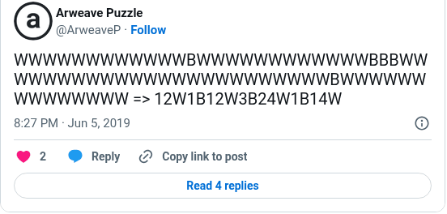

# Weave 4 run length hint

[Original post](https://x.com/ArweaveP/status/1136338881593450497). Cited by the [Weave 4 record](../../../src/collections/weave/4.ts) as an official hint. Tiamat posted it as a reply to the Puzzle #4 announcement, a week later.

## Historical provenance

No capture found. The Wayback Machine index and the MemGator aggregator were searched on October 16, 2026 for both the `twitter.com` and `x.com` URL. The oldest trace is the [October 21, 2021 capture of the Puzzle #4 announcement](https://web.archive.org/web/20211021175327/https://twitter.com/ArweaveP/status/1133762146406457345), whose reply list carries this post with the same wording. So the transcript below was checked against that capture, the current embed and the screenshot.

## Transcript

> WWWWWWWWWWWWBWWWWWWWWWWWWBBBWWWWWWWWWWWWWWWWWWWWWWWWBWWWWWWWWWWWWWW => 12W1B12W3B24W1B14W

## Screenshot

The displayed 8:27 PM timestamp is local to the capture browser. The frontmatter date is June 5 in UTC. Capture method and limits: [source archive](../README.md).
