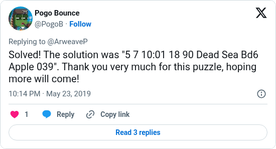

# Weave 1 answer from its solver

[Original post](https://x.com/PogoB/status/1131654631250178049). Cited by the [Weave 1 solver record](../../../src/collections/weave/1.ts) as the solver's own claim: a reply to the Puzzle #1 launch tweet with the whole answer, twenty minutes after the claim transaction. ZorenX's write-up names the same solver as pogo a year later. The post identifies a handle, not a person.

## Historical provenance

No capture found. The Wayback Machine index and the MemGator aggregator were searched on October 19, 2026 for both the `twitter.com` and `x.com` URL. The oldest trace is the [October 21, 2021 capture of the Puzzle #1 launch tweet](https://web.archive.org/web/20211021175346/https://twitter.com/ArweaveP/status/1131629325126656002), whose reply list carries this post with the same wording. So the transcript below was checked against that capture, the current embed and the screenshot.

## Transcript

> Solved! The solution was "5 7 10:01 18 90 Dead Sea Bd6 Apple 039". Thank you very much for this puzzle, hoping more will come!

## Screenshot

The displayed 10:14 PM timestamp is local to the capture browser. The frontmatter date is May 23 in UTC. Capture method and limits: [source archive](../README.md).
