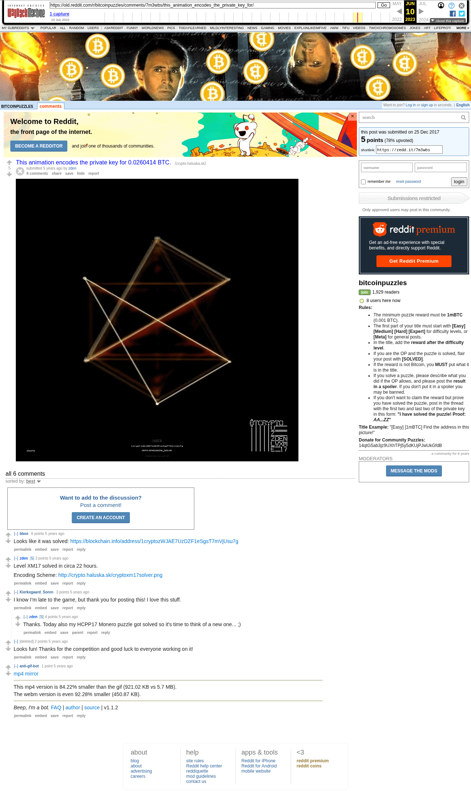

# This animation encodes the private key for 0.0260414 BTC.

[Original thread](https://www.reddit.com/r/bitcoinpuzzles/comments/7m3wbs/this_animation_encodes_the_private_key_for/). Zden's Christmas post of Level XM17 and the `sourceUrl` of the [zden/level-xm17](../../../src/collections/zden/level-xm17.ts) record. It's a link post: the prize sits in the title, the link goes to `cryptoxm17.gif`, and there's no body at all. It went up on December 25, 2017, at 22:09:21 UTC, 28 hours after the funding transaction. It was never edited.

The first reply came 59 seconds later, from a bot that found the GIF too heavy. Fair enough, it's 5.7 MB. The claim transaction landed 21 hours and 19 minutes after the post, and bboe pointed at the empty address ten minutes after that. The next day Zden wrote "circa 22 hours" and linked the encoding scheme. That's where the record's `binary` technique comes from. Every WIF character is a Base58 index, six bits, and the set bits are corners of a hexagon. So the GIF is a key, drawn one hexagon at a time. The scheme image is the record's solution asset, so it isn't copied here.

## Historical provenance

The Wayback Machine holds one capture each of the `www.reddit.com` and `old.reddit.com` URLs, a second apart on June 10, 2023. The `www` one is Reddit's app shell with the title and the author and no comment. Provenance rests on the [old.reddit.com capture](https://web.archive.org/web/20230610011703/https://old.reddit.com/r/bitcoinpuzzles/comments/7m3wbs/this_animation_encodes_the_private_key_for/), stamped 01:17:03 UTC. Its HTML carries the post and all 6 comments the header counts, and their text matches the transcript once Markdown is rendered. It was read on October 14, 2026. `archive_content: confirmed` on that basis. archive.today answered 404 for the `www.reddit.com`, `old.reddit.com` and bare `reddit.com` timemaps the same day.

The transcript takes the comment text from the [Arctic Shift](https://arctic-shift.photon-reddit.com/) Reddit archive, read on October 14, 2026, which keeps the Markdown the page renders. The [pullpush](https://pullpush.io/) Reddit archive, read the same day, gives the same post, time and comment count. Its 6 comments match byte for byte, with the same authors, times and parents. The order and the scores below are the capture's. Both archives recorded their own scores, and four of the seven differ from the capture. By 2023 KarlFoster's account was gone and the capture shows the comment under `[deleted]`. The name comes from both archives.

The record names none of the commenters as the solver. bboe only spotted the spend, and nothing on the chain ties the claim to a Reddit account.

## Transcript

> This animation encodes the private key for 0.0260414 BTC.

The post links the GIF at http://crypto.haluska.sk/cryptoxm17.gif.

## Comments

In the capture's order, "sorted by best".

**u/bboe**, 6 points:

> Looks like it was solved: https://blockchain.info/address/1cryptozWJAE7UzDZF1eSgsT7mVjUsu7g

**u/zden**, 3 points:

> Level XM17 solved in circa 22 hours.
>
> Encoding Scheme: http://crypto.haluska.sk/cryptoxm17solver.png

**u/Kierkegaard_Soren**, 3 points:

> I know I’m late to the game, but thank you for posting this! I love this stuff.

**u/zden**, 4 points, reply to u/Kierkegaard_Soren:

> Thanks. Today also my HCPP17 Monero puzzle got solved so it's time to think of a new one... ;)

**u/KarlFoster**, 2 points:

> Looks fun! Thanks for the competition and good luck to everyone working on it!

**u/anti-gif-bot**, 1 point:

> [mp4 mirror](https://gfycat.com/QuarterlyIgnorantKid)
>
> ---
>
> This mp4 version is 84.22% smaller than the gif (921.02 KB vs 5.7 MB).
> The webm version is even 92.28% smaller (450.87 KB).
>
> ---
>
> _Beep, I'm a bot._ [FAQ](https://np.reddit.com/r/anti_gif_bot/wiki/index) | [author](https://np.reddit.com/message/compose?to=MrWasdennnoch) | [source](https://github.com/wasdennnoch/reddit-anti-gif-bot) | v1.1.2

## Screenshot

The screenshot is a render of the archive capture, not of the live page, so it carries the Wayback banner at the top. The "5 years ago" stamps are relative to the capture, June 10, 2023. Capture method and limits: [source archive](../README.md).
