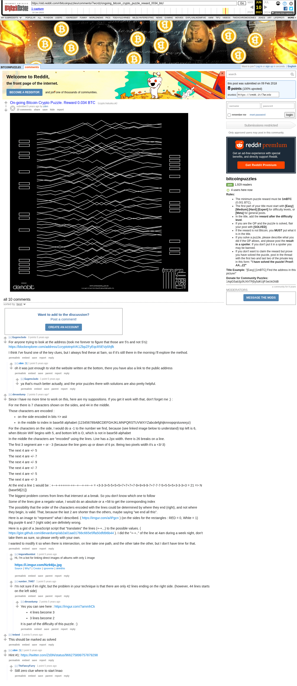

# On-going Bitcoin Crypto Puzzle. Reward 0.034 BTC

[Original thread](https://www.reddit.com/r/bitcoinpuzzles/comments/7wcrdz/ongoing_bitcoin_crypto_puzzle_reward_0034_btc/). Zden's r/bitcoinpuzzles post of the Demobit puzzle. The [zden/demobit-2018](../../../src/collections/zden/demobit-2018.ts) record takes two hints from it. It's a link post. The prize sits in the title, the link goes to `crypto_db18.png`, and there's no body. It went up on February 9, 2018, at 11:12:35 UTC. It was never edited.

So is this the launch? No. The coins landed on January 23. On February 3 Zden [tweeted](https://twitter.com/Zd3N/status/959812320200404993) the puzzle as a "@Demobit special", the weekend of the demoparty in Bratislava. Reddit got it six days later. That's why the record keeps the image as its `sourceUrl` and the funding as `startedAt`. Level XM17 went the other way: its record starts at its Reddit post.

The title says 0.034 BTC. The address held 0.03499755 then. On March 22 Zden topped it up with 0.01500245, which made it exactly 0.05 BTC. Three days later the claim took all of it. The record used to carry the top-up alone as its `prize`. Now it says 0.05, what the address held before the claim. Most records with a top-up do the same.

The comments are short on answers and long on squinting. EugeneJudo kept reading the 5s in the address as Ss. Zden pointed him at the website printed under the image. That's an `official` hint now. Then dievardump dropped a whole decoding theory. 7 characters on the sides, 44 in the middle, the middle lines as Base58 indices. 7 plus 44 is 51, the length of an uncompressed WIF. And the claim did reveal an uncompressed public key. Not bad for 4am. The line arithmetic stays his guess, since nobody confirmed it. So the record keeps only the count, as a `community` hint. Zden's last comment just links Hint #1, 55 seconds after the tweet the record already cites. Nobody in the thread posted the key. In April tedand asked for the post to be marked solved, 18 days after the claim.

## Historical provenance

The Wayback Machine holds one capture each of the `www.reddit.com` and `old.reddit.com` URLs. They're four seconds apart, on June 10, 2023. The `www` one is Reddit's app shell with the title and no comment. Provenance rests on the [old.reddit.com capture](https://web.archive.org/web/20230610082443/https://old.reddit.com/r/bitcoinpuzzles/comments/7wcrdz/ongoing_bitcoin_crypto_puzzle_reward_0034_btc/), stamped 08:24:43 UTC. Its HTML carries the post and all 10 comments the header counts. Every quoted line below matches its text once Markdown is rendered, 39 of 39. It was read on October 14, 2026. `archive_content: confirmed` on that basis. archive.today answered 404 for the `www.reddit.com`, `old.reddit.com` and bare `reddit.com` timemaps the same day.

The comment text comes from the [Arctic Shift](https://arctic-shift.photon-reddit.com/) Reddit archive, read on October 14, 2026. It keeps the Markdown the page renders. The [pullpush](https://pullpush.io/) Reddit archive, read the same day, lists the same 10 comments. Same authors, times and parents. The order and the scores below are the capture's. Both archives give EugeneJudo's first comment 2 points and tedand's 1. The capture shows 3 and 2.

## Transcript

> On-going Bitcoin Crypto Puzzle. Reward 0.034 BTC

The post links the image at http://crypto.haluska.sk/crypto_db18.png.

## Comments

**u/EugeneJudo**, 3 points:

> For anyone trying to look at the address (took me forever to figure that those are 5's and not S's):
> https://blockexplorer.com/address/1cryptotnptVK1ZbpZFyEqcR5EVp5hjfk
>
> I think I've found one of the key clues, but I always find these at 5am, so if it's still there in the morning i'll explore the method.

**u/zden**, 1 point, reply to u/EugeneJudo:

> oh it was just enough to visit the website written at the bottom, there you have also a link to the public address

**u/EugeneJudo**, 1 point, reply to u/zden:

> ya that's much better actually, and the prior puzzles there with solutions are also pretty helpful.

**u/dievardump**, 2 points:

> Since I have no more time to work on this, here are my suppositions. If you get it work with that, don't forget me ;) :
>
> For me there is 7 characters shown on the sides, and 44 in the middle.
>
> Those characters are encoded :
>
> - on the side encoded in bits => asii
>
> - in the middle to index in base58 alphabet (123456789ABCDEFGHJKLMNPQRSTUVWXYZabcdefghijkmnopqrstuvwxyz)
>
> For the characters on the side, I would do a -1 to the number we find, because (see linked image below to understand) top left is 6, when Bitcoin WIF begins with 5, and bottom left is O, which is not in base58 alphabet
>
> In the middle the characters are "encoded" using the lines. Line has a 2px width. there is 26 breaks on a line.
>
> The first 3 segment are + or - 3 (because the line goes up or down of 6 px. Being two pixels width it's a +3/-3)
>
> The next 4 are +/- 5
>
> The next 4 are +/- 7
>
> The next 4 are +/- 9
>
> The next 4 are +/- 7
>
> The next 4 are +/- 5
>
> The next 4 are +/- 3
>
> At the end a line 1 would be : +--+-++++++-++--+---+-++--+ = +3-3-3+5-5+5+5+7+7+7+7-9+9+9-9-7+7-7-7-5+5-5+5+3-3-3+3 = 21 => N (base58[21])
>
> The biggest problem comes from lines that intersect at a break. So you don't know which one to follow
>
> Some of the lines give a negativ value, I would do an absolute or a +58 to get the corresponding index
>
> The possibility that the order of the characters encoded with the lines could be determined by where they end (right), and not where they begin, is valid. That, because the last 2 are shorter than the others, maybe saying "we end all this".
>
> Here is an image to "represent" what I described. ( https://imgur.com/a/IPgcn ) (on the sides for the rectangles : RED = 0, White = 1)
> Big purple 6 and 7 (right side) are definitely wrong.
>
> Here is a gist of a JavaScript script that "translates" the lines (+-+...) to the possible values. ( https://gist.github.com/dievardump/ab2a01aa01766c665e5ffa50dfd96b44 ). I did the "+-+.." of the line at 4am during a week night, don't take them as sure, so please verify with your own.
>
> I wanted to modify it so when there is intersection, on line take one path, and the other take the other, but I don't have time for that.

**u/imguralbumbot**, 1 point, reply to u/dievardump:

> ^(Hi, I'm a bot for linking direct images of albums with only 1 image)
>
> **https://i.imgur.com/Nz94Iju.jpg**
>
> ^^[Source](https://github.com/AUTplayed/imguralbumbot) ^^| ^^[Why?](https://github.com/AUTplayed/imguralbumbot/blob/master/README.md) ^^| ^^[Creator](https://np.reddit.com/user/AUTplayed/) ^^| ^^[ignoreme](https://np.reddit.com/message/compose/?to=imguralbumbot&subject=ignoreme&message=ignoreme) ^^| ^^[deletthis](https://np.reddit.com/message/compose/?to=imguralbumbot&subject=delet%20this&message=delet%20this%20dv5wh3s)

**u/number_70457**, 1 point, reply to u/dievardump:

> I'm not sure if im right, but the problem in your technique is that there are only 42 lines ending on the right side. (however, 44 lines starts on the left side)

**u/dievardump**, 2 points, reply to u/number_70457:

> Yes you can see here : https://imgur.com/7ammhCk
>
> - 4 lines become 3
>
> - 3 lines become 2
>
> It is part of the difficulty of this puzzle. :)

**u/tedand**, 2 points:

> This should be marked as solved

**u/zden**, 1 point:

> Hint #1: https://twitter.com/Zd3N/status/966275899757879298

**u/TheFancyFurry**, 1 point, reply to u/zden:

> Still zero clue where to start lmao

## Screenshot

The screenshot is a render of the archive capture, not of the live page, so it carries the Wayback banner at the top. The "5 years ago" stamps are relative to the capture, June 10, 2023. Capture method and limits: [source archive](../README.md).
